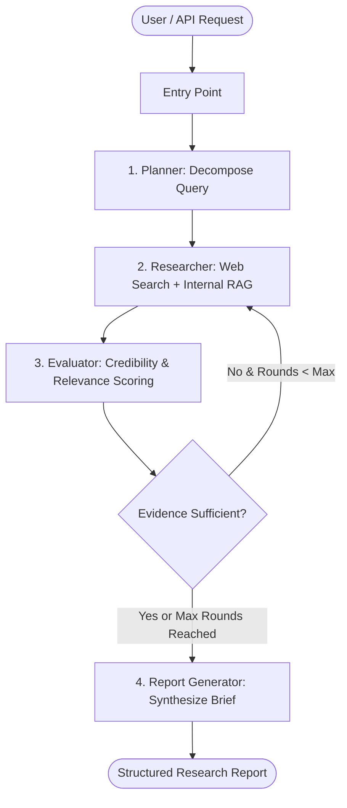

# 🔍 Enterprise AI Research Agent

[](https://www.python.org/downloads/)
[](https://github.com/langchain-ai/langgraph)
[](https://fastapi.tiangolo.com/)
[](https://streamlit.io/)
[](https://opensource.org/licenses/MIT)
[](#-automated-testing)

An autonomous, multi-step enterprise research assistant built with **LangGraph**, **FastAPI**, **Streamlit**, and **OpenAI**. The agent dynamically decomposes research questions, queries public web sources and internal documents, evaluates source credibility and coverage, performs bounded iterative searches to fill evidence gaps, and synthesizes structured, source-grounded research briefs with bracketed citations.

---

## 🌟 Key Features

- **🧠 Dynamic Planning (`Planner`)**: Decomposes natural language queries into 3–5 targeted, search-ready subtopics with LLM structured output and deterministic fallbacks.
- **🌐 Hybrid Information Retrieval (`Researcher`)**:
  - Live external web search with bounded exponential retries.
  - Internal Enterprise Document Retrieval (RAG/local markdown & document store).
- **⚖️ Automated Evidence Evaluation (`Evaluator`)**:
  - Domain credibility classification (Academic `.edu`, Government `.gov`, Trusted Publishers, General Web, Low-confidence).
  - Relevance scoring (keyword density and topical alignment).
  - Content density, freshness, and duplicate URL suppression.
- **🔄 Cyclical LangGraph Orchestrator**:
  - Evaluates topical coverage and evidence sufficiency.
  - Conditionally re-routes back to the researcher to fill gaps or proceeds to report generation if criteria are satisfied or max rounds are reached.
- **📄 Source-Grounded Synthesis (`Report Generator`)**:
  - Synthesizes executive summary, methodology, detailed analysis with inline citations `[1]`, evidence limitations, and full source references.
- **🖥️ Multiple Production Interfaces**:
  - **FastAPI REST API**: Async queuing (`/research`), synchronous execution (`/research/sync`), and polling (`/research/{task_id}`).
  - **Streamlit Web UI**: Interactive dashboard to trigger research, inspect evaluated sources, and download markdown briefs.
- **🐳 Container-Ready**: Fully dockerized with multi-service `docker-compose`.

---

## 🏗️ System Architecture



---

## 📁 Repository Structure

```
ai-research-agent/
├── app/
│   ├── agents/
│   │   ├── planner.py            # Research objective decomposition
│   │   ├── researcher.py         # Multi-source information gathering
│   │   ├── evaluator.py          # Credibility & relevance evaluation
│   │   └── report_generator.py   # Citation-grounded synthesis
│   ├── schemas/
│   │   └── research_state.py     # Typed research state dictionary
│   ├── services/
│   │   └── llm_service.py        # LangChain OpenAI client setup
│   ├── tools/
│   │   ├── web_search.py         # Web search with retry logic
│   │   └── internal_retrieval.py # Enterprise internal docs reader
│   ├── api.py                    # FastAPI REST API endpoints
│   ├── config.py                 # Pydantic environment configuration
│   ├── ui.py                     # Streamlit web dashboard
│   └── workflow.py               # LangGraph compiled state graph
├── data/
│   └── internal_docs/            # Local enterprise documents for RAG
├── docs/
│   ├── SYSTEM_ARCHITECTURE.md    # Detailed architectural specifications
│   └── WORKFLOW_SPECIFICATION.md # LangGraph transition specifications
├── tests/                        # 16 unit & integration tests
├── .env.example                  # Environment template
├── .gitignore                    # Git ignore file (prevents secret leaks)
├── docker-compose.yml            # Multi-container orchestration
├── Dockerfile                    # Container build file
├── requirements.txt              # Production dependencies
└── README.md
```

---

## ⚡ Quickstart Guide

### 1. Clone & Set Up Environment

```bash
git clone https://github.com/vijayreddyperudi/Research-Agent.git
cd Research-Agent

# Create and activate virtual environment
python -m venv .venv
.\.venv\Scripts\Activate.ps1   # On Windows (or source .venv/bin/activate on Linux/Mac)

# Install dependencies
pip install -r requirements.txt
```

### 2. Configure Environment Variables

Copy the example file and add your OpenAI API key:

```bash
cp .env.example .env
```

Edit `.env`:
```env
OPENAI_API_KEY=your_openai_api_key_here
OPENAI_MODEL_NAME=gpt-4o-mini
MAX_RESEARCH_ROUNDS=3
MIN_USEFUL_SOURCES=5
```

---

## 🚀 Running the Project

### Option A: Streamlit Interactive Web UI

```bash
streamlit run app/ui.py
```
Open **[http://localhost:8501](http://localhost:8501)** in your browser.

### Option B: FastAPI Backend API

```bash
uvicorn app.api:app --host 0.0.0.0 --port 8000 --reload
```
- Access interactive Swagger documentation at **[http://localhost:8000/docs](http://localhost:8000/docs)**.

### Option C: Docker Compose

```bash
docker-compose up --build
```

---

## 🧪 Automated Testing

Run the test suite with Pytest:

```bash
pytest -v tests/
```

Test coverage includes:
- Planner decomposition
- Web search retries and empty query handling
- Internal document keyword matching
- Domain credibility scoring
- LangGraph conditional routing
- FastAPI async job queue & health check

---

## 🔒 Security & Privacy

- Sensitive credentials (`OPENAI_API_KEY`) are kept in `.env` and excluded from source control via `.gitignore`.
- UI does not render API keys on screen.
- Web search handles retries with bounded exponential backoff to avoid hammering upstream providers.

---

## 📜 License

This project is licensed under the MIT License - see the LICENSE file for details.
